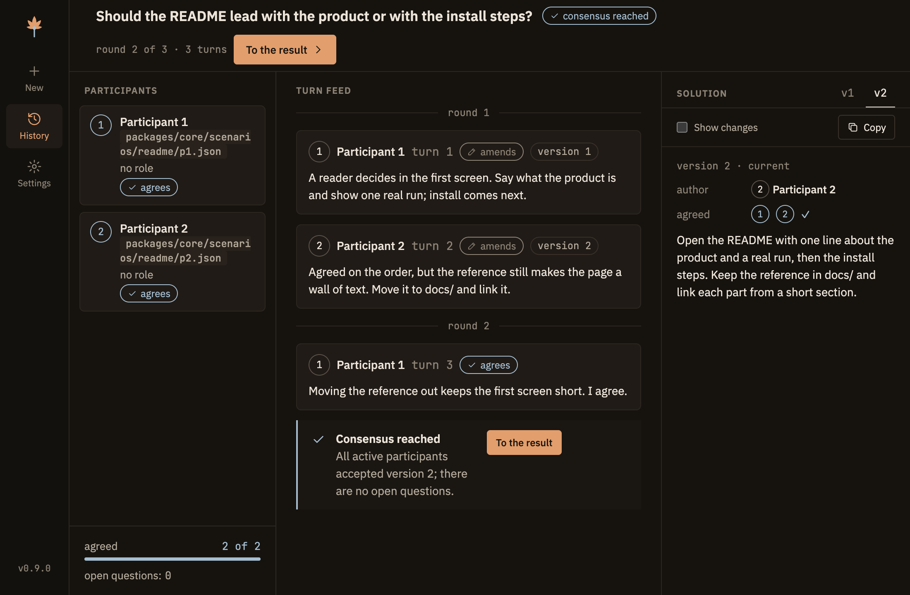

<picture>
  <source media="(prefers-color-scheme: dark)" srcset="design/mockup-osen/brand/svg/osen-logo.svg">
  
</picture>

**Ask several models once. Get one answer they all signed.**

[](CHANGELOG.md)
[](https://github.com/seasons-ai/Osen/actions/workflows/ci.yml)
[](docs/deploy.md)
[](LICENSE)

Claude, Codex and any OpenAI-compatible model take turns on your problem. Each turn amends one shared solution, accepts it or objects. The session ends when every participant accepts the same version — or tells you plainly that they did not.



> **Early.** Built for one owner on macOS. Every mechanism is tested on scripted participants with zero model calls; acceptance on real providers is in progress.

## How it works

- **The engine runs the discussion, not the models.** Turn order, who agreed and when the session ends are decided by code. A model cannot declare consensus in prose.
- **Nothing is lost.** A session is a journal of events; its state is rebuilt from the journal, so a killed process is resumed where it stopped.
- **Participants are sealed.** No tools, no MCP servers, no access to your disk. Your files reach them only as text, through the engine.
- **You stay in the loop.** Add a remark mid-discussion, answer the models' questions, pause after each round, or pick a version yourself.

## Download

You need macOS on Apple Silicon and at least one participant: the `claude` or `codex` CLI signed in, or an OpenAI-compatible endpoint. Node is not needed for the app. From the first release after 0.10.0 the `osen` MCP server and the `council` command also run from the app bundle without Node; in 0.10.0 and earlier they need a clone of the repository. Running from a clone of the repository still needs Node 22.18+ (see "From source").

1. Download `osen-<version>-arm64.dmg` from the [latest release](https://github.com/seasons-ai/Osen/releases/latest).
2. Open the image and drag `Osen` to "Applications".
3. Open `Osen`. The app has no Apple developer signature, so the first time macOS refuses to open it: press "Done", then open "System Settings" → "Privacy & Security", scroll down and press "Open Anyway". Later launches open normally.

If macOS says the app is damaged, run `xattr -dr com.apple.quarantine /Applications/Osen.app` in Terminal and open it again. Details and updates: [docs/deploy.md](docs/deploy.md).

## From source

You need macOS on Apple Silicon, Node 22.18+, and at least one participant: the `claude` or `codex` CLI signed in, or an OpenAI-compatible endpoint.

```bash
git clone https://github.com/seasons-ai/Osen.git
cd Osen
npm install
npm run desktop
```

The window opens on "History"; press "New" to start a discussion. To build the `.dmg` yourself: `npm run dist`, then [docs/deploy.md](docs/deploy.md).

Try it without spending anything — two scripted participants, 0 model calls:

```bash
COUNCIL_DEV=1 COUNCIL_HOME=.council-data npx council --topic "Should the README lead with the product or with the install steps?" --participant scripted:packages/core/scenarios/readme/p1.json --participant scripted:packages/core/scenarios/readme/p2.json --max-rounds 3
```

```console
── Turn 1 · round 1 · p1 «Participant 1» · amend → version 1
Arguments: A reader decides in the first screen. Say what the product is and show one real run; install comes next.
── Turn 2 · round 1 · p2 «Participant 2» · amend → version 2
Arguments: Agreed on the order, but the reference still makes the page a wall of text. Move it to docs/ and link it.
── Turn 3 · round 2 · p1 «Participant 1» · agree
Arguments: Moving the reference out keeps the first screen short. I agree.

══ Outcome: consensus
Version 2, author p2
Agreed: p1, p2
```

<sub>Output trimmed: the raw JSON of each turn and the usage lines are left out.</sub>

## Three ways to run

| From | Command | Guide |
|---|---|---|
| The app | `npm run desktop` | [docs/desktop.md](docs/desktop.md) |
| The terminal | `npx council --topic "…" --participant claude:haiku --participant codex --max-rounds 2` | [docs/cli.md](docs/cli.md) |
| Claude Code, Codex or Claude Desktop | the `osen` MCP server and skill — below | [docs/mcp.md](docs/mcp.md) |

With the installed app (releases after 0.10.0), "Settings" → "Connections" connects Claude Desktop, Claude Code and Codex to the server inside the app and installs the `council` command into `~/.local/bin`; no Node and no repository are needed ([docs/mcp.md, "From the installed app"](docs/mcp.md#from-the-installed-app)). What is proven for each client, and what is not yet: [docs/clients.md](docs/clients.md).

Real participants spend your subscription or money. Through MCP, an agent must show you the topic, participants and call bound before a start, and wait for your consent.

### Connecting in this project

The `osen` server is already listed in `.mcp.json`. Start `claude` in the repository root, confirm the project server `osen` when asked, and check with `/mcp`: it shows seven tools. Codex, the permanent install and the skill: [docs/mcp.md](docs/mcp.md).

## What's inside

- **Participants** — `claude` and `codex` CLIs, any OpenAI-compatible HTTP endpoint, saved [lineups](docs/cli.md#lineups), and discussion [templates](docs/templates.md) with roles and rules.
- **Materials** — files, folders, PDFs and links in every turn; large folders are read on request, `.gitignore` applies. [docs/materials.md](docs/materials.md)
- **Owner control** — [messages](docs/cli.md#owners-message), [questions to you](docs/cli.md#questions-to-the-owner), [waiting](docs/cli.md#waiting-for-the-owner), your own choice of version, macOS notifications.
- **Cost** — a [token ceiling](docs/cli.md#token-ceiling), usage by period and provider, a separate [tariff estimate](docs/desktop.md#usage-in-history).
- **Sessions** — [resume](docs/cli.md#resuming-a-session) with a replaced participant, Markdown export, English and Русский.
- **Experiment** — [independent drafts](docs/cli.md#independent-drafts-experiment): each model drafts alone before the discussion.

## Limits

- macOS on Apple Silicon only. No web version, no auto-update.
- The image is not signed by Apple: the first launch needs ["Open Anyway"](docs/deploy.md#first-launch-of-an-unsigned-app).
- The MCP server and the `council` command from the app are checked on scripted participants only; a real discussion through each agent client has not been run yet ([docs/clients.md](docs/clients.md)).
- A token ceiling, not a money ceiling: providers do not always report usage, so a total in dollars would be a guess.
- No memory between sessions.

## Roadmap

- **Next** — the same paths on the installed app with real `claude`, `codex` and HTTP participants, real agent dialogs over MCP, macOS dialogs and notifications.
- **Later** — candidates, no commitment: full-text search over decisions, comparing any two versions, exporting only the final decision.

## More

[Data folder and formats](docs/data.md#data) · [Versions and releases](docs/releases.md) · [Contributing](CONTRIBUTING.md) · [Security](SECURITY.md)

MIT [licence](LICENSE). Fonts: IBM Plex Sans and JetBrains Mono, SIL Open Font License 1.1.
